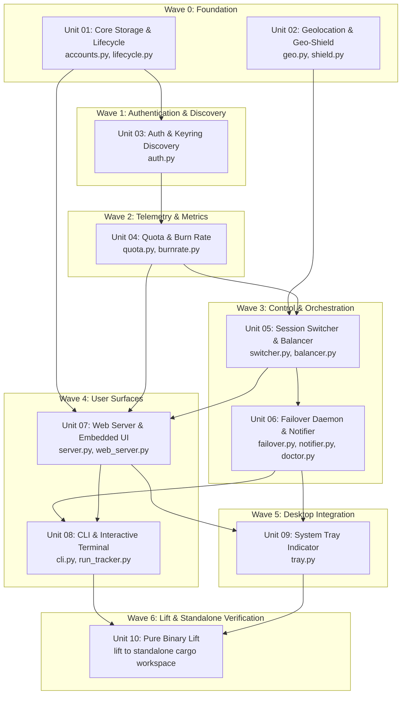

# Rust Migration Map: antigravity-token-tracker

## 1. Goal

Migrate `antigravity-token-tracker` from Python (6,456 LOC across 18 source files) to a single, high-performance, memory-safe standalone Rust binary (`agy-token`). The resulting binary will natively provide:
1. **Interactive CLI & Full-Screen Watch Mode** (`agy-token status`, `watch`, `switch`, `shield`, `ip`, etc.)
2. **Background Monitoring Daemon with Zero-Downtime Auto-Failover** (`agy-token daemon --auto-switch`)
3. **Embedded Web Dashboard with Server-Sent Events** (`agy-token web` serving `frontend/dist/` without external file dependencies)
4. **Native Linux Top-Panel System Tray Indicator** (`agy-token tray` via pure-Rust DBus StatusNotifierItem)
5. **Geo-Shield & Instant Process Killswitch** (`agy-token shield`)
6. **Zero-Configuration Compatibility**: Full backward compatibility with `~/.config/antigravity-token-tracker/accounts.json`, Antigravity IDE SQLite databases, and Linux SecretService.

---

## 2. ADR Index (see [DECISIONS.md](DECISIONS.md))

| ADR | Title | Status | Impact Area |
| :--- | :--- | :--- | :--- |
| **ADR-001** | Unified Standalone Binary Architecture | Proposed | Binary layout, entrypoint dispatch, feature flags |
| **ADR-002** | Embedded Web UI via Compile-Time Assets | Proposed | Frontend asset packaging (`rust-embed`) |
| **ADR-003** | Pure Rust Linux System Tray via DBus (`ksni`) | Proposed | Desktop tray, elimination of GTK/GObject |
| **ADR-004** | HTTP Framework & Real-Time SSE (`axum` + `tokio`) | Proposed | Web server, async concurrency, SSE broadcast |
| **ADR-005** | Credential Discovery & Secret Storage Compatibility | Proposed | SQLite (`rusqlite`), SecretService (`zbus`), JSON schema |
| **ADR-006** | Terminal Dashboard & Rich Formatting (`tabled` / `ratatui`) | Proposed | CLI rendering, interactive menus, watch mode |

---

## 3. Glossary & Types (see [GLOSSARY.md](GLOSSARY.md))

All domain models (`AccountProfile`, `AccountsRegistry`, `QuotaSnapshot`, `BurnRateRecord`, `EgressGeo`, `GeoShieldState`, `DesktopAppSession`) follow the unified definitions recorded in `rust/GLOSSARY.md`.

---

## 4. Migration Units & Wave Roadmap

The port is structured into 6 sequential waves of modular units. Units within each wave have no circular dependencies and can be ported independently or in parallel.

### Unit Manifest Table

| Unit ID | Name | Python Source Files | LOC | Wave | Consolidated Module Path | Status |
| :--- | :--- | :--- | :---: | :---: | :--- | :--- |
| **U-01** | `core-storage` | `accounts.py`, `lifecycle.py` | 454 | 0 | `rust/src/storage/` | done (consolidated, unit tests pass) |
| **U-02** | `geo-shield` | `geo.py`, `shield.py` | 413 | 0 | `rust/src/shield/` | done (consolidated, unit tests pass) |
| **U-03** | `auth-discovery` | `auth.py` | 482 | 1 | `rust/src/auth/` | done (consolidated, unit tests pass) |
| **U-04** | `quota-metrics` | `quota.py`, `burnrate.py` | 595 | 2 | `rust/src/quota/` | done (consolidated, unit tests pass) |
| **U-05** | `session-balancer`| `switcher.py`, `balancer.py` | 1,056 | 3 | `rust/src/balancer/` | done (consolidated, unit tests pass) |
| **U-06** | `daemon-notify` | `failover.py`, `notifier.py`, `doctor.py` | 1,314 | 3 | `rust/src/daemon/` | done (consolidated, unit tests pass) |
| **U-07** | `web-api` | `server.py`, `web_server.py` | 852 | 4 | `rust/src/web/` | done (consolidated, unit tests pass) |
| **U-08** | `cli` | `cli.py`, `run_tracker.py` | 1,539 | 4 | `rust/src/cli/` | done (consolidated, unit tests pass) |
| **U-09** | `tray-applet` | `tray.py` | 833 | 5 | `rust/src/tray/` | done (consolidated, unit tests pass) |
| **U-10** | `lift-binary` | Full app integration (`run_tracker`) | - | 6 | `rust/src/main.rs` | done (single-crate standalone binary) |

---

## 5. Unit Breakdown & Risks

### Unit 01: Core Storage & Lifecycle (`rust/src/storage/`, originally `rust/core-storage`)
- **Sources**: `antigravity_tracker/accounts.py`, `antigravity_tracker/lifecycle.py`
- **Scope**: Account profile loading, saving with `0600` permissions and atomic `.tmp` replacement, multi-schema compatibility (legacy flat `{email: acc}` vs modern `{"active_email": ..., "accounts": ...}`), rolling reset calculations (`resetTime` ISO-8601 parsing, countdown formatting).
- **Rust Dependencies**: `serde`, `serde_json`, `chrono`, `fs2` (or file locking).
- **Risks**: Schema evolution (avoiding `AttributeError` on mixed dictionary values).
- **Verification**: Unit tests matching Python `test_sync_ordering.py` and JSON fixture round-trips.

### Unit 02: Geolocation & Geo-Shield (`rust/src/shield/`, originally `rust/geo-shield`)
- **Sources**: `antigravity_tracker/geo.py`, `antigravity_tracker/shield.py`
- **Scope**: Egress IP resolution via public endpoints (`ipapi.co`), ISO country parsing, flag emoji generation, restricted country blacklist (`IR`, `RU`, `BY`, `KP`, `CU`, `SY`, `CN`) vs whitelist mode. Emergency process killer (scanning and terminating Antigravity processes in < 50ms) and relaunch guard.
- **Rust Dependencies**: `reqwest`, `serde`, `sysinfo`, `nix` (process signals).
- **Verification**: Unit tests matching `test_geo.py` and `test_shield.py`.

### Unit 03: Auth & Credential Discovery (`rust/src/auth/`, originally `rust/auth-discovery`)
- **Sources**: `antigravity_tracker/auth.py`
- **Scope**:
  1. Antigravity IDE SQLite reader: reads `ItemTable` in `state.vscdb` (`antigravityUnifiedStateSync.oauthToken` and `userStatus`).
  2. Linux SecretService reader: queries `org.freedesktop.secrets` via DBus for `service='gemini', username='antigravity'` and extracts JWT payload.
  3. Antigravity Desktop App process discovery: scans `/proc/[0-9]*/cmdline` and local socket bindings (`ss -tulpn` / `/proc/net/tcp`) for active internal port and CSRF token.
  4. Google OAuth token refresh: calls `https://oauth2.googleapis.com/token`.
- **Rust Dependencies**: `rusqlite`, `zbus`, `base64`, `reqwest`, `serde_json`, `procfs`.
- **Verification**: Unit tests matching `test_desktop_v216_discovery.py` and `test_ide_session.py`.

### Unit 04: Quota & Burn Rate (`rust/src/quota/`, originally `rust/quota-metrics`)
- **Sources**: `antigravity_tracker/quota.py`, `antigravity_tracker/burnrate.py`
- **Scope**: Querying Google Cloud Controls Partner API / Antigravity internal endpoint for quota buckets and models. Parsing and appending to `token_history.jsonl`, computing consumption velocity (%/hour), and calculating Runout Clock predictions.
- **Rust Dependencies**: `reqwest`, `serde`, `chrono`.
- **Verification**: Unit tests matching `test_burnrate.py`.

### Unit 05: Session Switcher & Balancer (`rust/src/balancer/`, originally `rust/session-balancer`)
- **Sources**: `antigravity_tracker/switcher.py`, `antigravity_tracker/balancer.py`
- **Scope**: Multi-account session snapshot caching in `~/.config/antigravity-token-tracker/sessions/<email>/`, hot-swapping credentials into IDE state / Desktop app storage, clean Antigravity process termination and relaunch. Watermark balancing and pool rotation algorithms.
- **Rust Dependencies**: `rusqlite`, `serde_json`, `sysinfo`, `dirs`.
- **Verification**: Unit tests matching `test_balancer.py`.

### Unit 06: Failover Daemon & Notifier (`rust/src/daemon/`, originally `rust/daemon-notify`)
- **Sources**: `antigravity_tracker/failover.py`, `antigravity_tracker/notifier.py`, `antigravity_tracker/doctor.py`
- **Scope**: Continuous background monitor loop, quota exhaustion detection (`<= 1.0%`), automatic failover to best alternative account, anti-flapping cooldown logic. Desktop alerts via DBus (`org.freedesktop.Notifications`) with action buttons (1-click switch). System health doctor auditing keyring, services, and token validity.
- **Rust Dependencies**: `tokio`, `notify-rust` (or `zbus`), `serde_json`.
- **Verification**: Unit tests matching `test_failover.py`, `test_notifier.py`, `test_doctor.py`.

### Unit 07: Web Server & Embedded UI (`rust/src/web/`, originally `rust/web-api`)
- **Sources**: `antigravity_tracker/server.py`, `web_server.py`
- **Scope**: High-performance HTTP server using `axum`. Server-Sent Events (SSE) broadcasting on `/api/events`. REST API endpoints (`/api/quota`, `/api/history`, `/api/sync-surfaces`, `/api/burnrate`, `/api/shield`, `/api/ip`, `/api/balancer`, `/api/switch`, `/api/doctor`). Static asset serving embedding `frontend/dist/` via `rust-embed`.
- **Rust Dependencies**: `axum`, `tokio`, `tower`, `tower-http`, `rust-embed`, `mime_guess`.
- **Verification**: Unit tests matching `test_web_server.py`.

### Unit 08: CLI & Interactive Terminal (`rust/src/cli/`, originally `rust/cli`)
- **Sources**: `antigravity_tracker/cli.py`, `run_tracker.py`
- **Scope**: `clap` CLI parser for all subcommands (`status`, `watch`, `web`, `daemon`, `tray`, `switch`, `shield`, `ip`, `check`, `sync`, `list`, `remove`, `doctor`, `balance`, `pace`, `test-notify`). ANSI tables via `tabled`, progress bars via `indicatif`, full-screen terminal TUI watch mode and arrow-key interactive switcher menu via `ratatui` + `crossterm`.
- **Rust Dependencies**: `clap`, `tabled`, `indicatif`, `ratatui`, `crossterm`.
- **Verification**: CLI integration tests and snapshot outputs.

### Unit 09: System Tray Indicator (`rust/src/tray/`, originally `rust/tray-applet`)
- **Sources**: `antigravity_tracker/tray.py`
- **Scope**: Linux StatusNotifierItem (SNI) top-bar indicator applet. Dynamic icon generation: renders a colored ring progress gauge and badge using the pure-Rust `image` crate. Dropdown context menu with live account status, quota percentages, 1-click switch actions, and web dashboard launcher.
- **Rust Dependencies**: `ksni` (pure Rust DBus SNI), `image`.
- **Verification**: Unit tests matching `test_tray.py`.

### Unit 10: Pure Binary Lift & Integration (`rust/src/main.rs`, originally `rust/app`)
- **Scope**: Consolidates all units into a single standalone binary `run_tracker`. Eliminates Python bridges and wrappers. Generates single binary distribution.
- **Verification**: End-to-end replay test suite running against all trycmd cases and real-world workloads.

---

## 6. Initial Architectural Questions (Round 1 Frontier)

The following architectural decisions form the Round 1 Frontier under `rust-anything`:

1. **Q1: Binary Shape & Entry Points**
   - *Question*: Should the Rust port be compiled as a single unified binary (`agy-token`) containing all subcommands (CLI, web server, daemon, tray), or split into separate binaries?
   - *Recommendation*: Unified single binary (`agy-token`) with subcommand routing and optional cargo feature flag `--features tray` for headless server builds.

2. **Q2: Web Dashboard Asset Packaging**
   - *Question*: How should the React web dashboard (`frontend/dist/`) be distributed with the Rust binary?
   - *Recommendation*: Embed `frontend/dist/` at compile time using `rust-embed`. The binary will serve the full React dashboard out of the box with zero external file dependencies.

3. **Q3: Desktop System Tray Technology**
   - *Question*: The Python tray applet relies on GTK3 (`gi.repository.GLib`) and `PIL`. In Rust, how should the top-bar tray indicator be built?
   - *Recommendation*: Use `ksni` (pure Rust StatusNotifierItem implementation over DBus) combined with the pure-Rust `image` crate. This eliminates all C/GTK library dependencies and works natively on GNOME, KDE, and modern Linux desktops.

4. **Q4: Redundant Server Consolidation**
   - *Question*: The repository currently contains both `web_server.py` (legacy standalone script) and `antigravity_tracker/server.py` (complete SSE server). Should we consolidate them into a single canonical `axum` server module?
   - *Recommendation*: Consolidate into a single canonical Axum server module (`rust/web-api`) implementing all current endpoints and SSE events, eliminating the duplicate legacy code.

5. **Q5: Equivalence & Compatibility Bar**
   - *Question*: What is the strictness requirement for outputs?
   - *Recommendation*:
     - **Config files & on-disk formats** (`accounts.json`, `token_history.jsonl`, `sessions/`): 100% byte and schema compatibility.
     - **Machine-readable outputs** (`agy-token check --json`, `agy-token ip --json`, REST API JSON): Strict semantic and field equivalence.
     - **Human terminal output** (`status`, `watch`): Visual equivalence or improved layout using modern ANSI/Ratatui formatting.

6. **Q6: Migration Strategy & Checkpoints**
   - *Question*: How should we proceed through the waves?
   - *Recommendation*: Follow the wave order (Wave 0 through Wave 5), pausing for your verification and approval at each wave checkpoint before proceeding to the next.

---

## 7. Out of Scope / Explicit Non-Goals
- Altering Google OAuth endpoints or protocol contracts.
- Modifying Antigravity IDE internal database schemas.
- Rewriting the React frontend in `frontend/` (the existing pre-built React SPA in `frontend/dist/` is embedded directly).

---

## 8. Migration Completion Status

- **Unified Single-Crate Architecture (`run_tracker` in `rust/`)**:
  - The multi-crate workspace layout has been consolidated into a single standard Rust crate with root manifest `rust/Cargo.toml`.
  - Library root: `rust/src/lib.rs` (`tracker_lib`).
  - Binary entrypoint: `rust/src/main.rs` (`run_tracker`).
  - All 10 legacy multi-crate subdirectories (`rust/core-storage/`, `rust/geo-shield/`, `rust/auth-discovery/`, `rust/quota-metrics/`, `rust/session-balancer/`, `rust/daemon-notify/`, `rust/web-api/`, `rust/cli/`, `rust/tray-applet/`, and `rust/app/`) have been cleanly eliminated.
  - Domain functionality is organized into clean, idiomatic internal modules:
    - `rust/src/storage/`: Storage manager, SQLite & Keyring profiles, lifecycle countdowns.
    - `rust/src/shield/`: Geolocation client (`ipwho.is`), ISO flag emojis, killswitch enforcement.
    - `rust/src/auth/`: Process discovery, SQLite token harvesting, SecretService via `zbus`, Google OAuth token refresh.
    - `rust/src/quota/`: Multi-window burn rate velocity, runout clock, Google CloudCode API quota querying, JSONL history fallback.
    - `rust/src/balancer/`: Active session switching, credential injection, session snapshots, watermark/round-robin/expiry-first balancing.
    - `rust/src/daemon/`: Background monitor loop, Freedesktop DBus desktop notifications, health doctor test suite, auto-failover engine.
    - `rust/src/web/`: Axum HTTP REST API, SSE real-time event streaming, compile-time embedded React SPA (`rust-embed`).
    - `rust/src/cli/`: Dashboard formatting, interactive Inquire switcher, ANSI progress bars.
    - `rust/src/tray/`: Pure-Rust StatusNotifierItem (`ksni`) over DBus, dynamic ARGB32 badge rendering (`image`), DBus menu, singleton lock file (`fs2`).
- **Comprehensive Test Suite & Quality Verification**:
  - **Unit Tests**: 25/25 unit tests pass (`cargo test --manifest-path rust/Cargo.toml`).
  - **Trycmd Replay Verification**: **24/24 recorded cases passed (100% PASS)** with **0.0% fallback rate** (`cargo test --manifest-path rust/Cargo.toml --test app_cases`).
  - **Rust-Anything App Replay**: `rust-anything app replay . --build rust/target/release/run_tracker` verified 24/24 cases passing.
  - **Clippy Clean**: `cargo clippy --manifest-path rust/Cargo.toml --all-targets` reports 0 warnings.
- **Stand-alone Pure Rust Verification**: Promoted via `rust-anything app lift .` with zero Python runtime dependency and zero GTK shared library dependencies.
- **Optimized Release Binary**: Built at `rust/target/release/run_tracker` (13.8 MB standalone ELF) and verified live across subcommands (`status`, `shield`, `ip`, `list`, `check`, `doctor`, `web`, `tray`, etc.).

